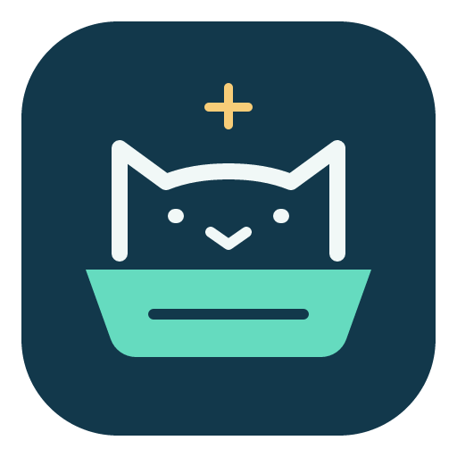

<h1 align="center">Cat Litter Hub – UPET / UBPet / AIRROBO / Robotail / Meowant</h1>

<p align="center">
  
</p>

<p align="center"><a href="README.md">🇬🇧 English</a> · <b>🇩🇪 Deutsch</b></p>


Eine Home-Assistant-Integration für smarte Katzenklos, die dieselbe Cloud-API nutzen: **UPET, UBPet, AIR PET, AIRROBO, Robotail und Meowant**. Mehrere Konten, Anbieter und Kontoregionen laufen nebeneinander in einer Integration, jedes mit eigener Verbindung.

**Stand: 2026.11.03.1 · Hardwaretest mit dieser Version noch offen.** Die Software wird automatisiert geprüft (Unit-Tests, Tests mit echten Home-Assistant-Klassen, Übernahme alter Einträge mit echten Registries). Eine passende API allein beweist aber nicht, dass jedes Modell jede Funktion unterstützt; was am C20 und an Robotail noch zu prüfen ist, steht in [TESTEN.md](docs/TESTING.md).

## Was die Integration kann

- **Anbieter und Region je Konto.** Die Region ist eine ausdrückliche Auswahl. Home-Assistant-Land und Zeitzone liefern nur die Vorauswahl und zeigen im Formular, woraus sie abgeleitet wurde (`EU · DE`, `NA · America/Chicago`).
- **Eine dauerhafte, verschlüsselte MQTT-Verbindung je Konto** für Statusmeldungen und Befehle; kein eigener Broker nötig. REST-Abgleich alle drei Minuten (60–3600 s einstellbar), zusätzlich nach Besuchs- und Konfigurationsmeldungen, höchstens vier parallele Abrufe je Konto.
- **Status und Diagnose:** Betriebsstatus, Gewicht, Abfallbehälter, Geruchsblock, Firmware, Online, Abdeckung, Trommel, Waage, Kamera, Licht, Anwesenheit der Katze. Hardwareabhängige Entitäten entstehen nur, wenn das Gerät sie meldet.
- **Besuchsverlauf** mit dauerhaft gespeicherter Deduplizierung und bis zu 10.000 Besuchen je Katze. Daraus abgeleitet: Besuche und Aufenthaltsdauer in 24 Stunden, **Besuche und Reinigungen heute**, letzte Reinigung, **Reinigungen seit Behälterreset** (ein Ersatz, falls der Zähler des Herstellers stehen bleibt), zuletzt benutzende Katze, Gewicht beim letzten Besuch und Gewichtsänderung.
- **Steuerung:** automatische Reinigung samt Verzögerung, Kindersicherung, Schüttelmodus, Fremdkörpererkennung, Behälterwarnung, Nicht-stören- und Lichtzeitplan, Leerungserinnerung (Uhrzeit, Voreinstellungen und einzelne Wochentage). Behälter und Geruchsblock zurücksetzen. Reinigung, Glätten und Streurechen sind nur freigegeben, wenn das Gerät es zulässt; ein Gerät, das im Leerlauf „läuft“ meldet, bleibt bedienbar.
- **Geplante Reinigungen** als Sensor (Anzahl aktiver, Zeiten als Attribut).
- **Ereignisse** `ubpet_visit`, `ubpet_box_event` und `ubpet_presence` für Automationen; bekannte Ereignisnummern tragen einen lesbaren `event_name`.
- **Neue Geräte und Katzen** werden im Betrieb entdeckt. Katzen mit gleicher Cloud-ID in verschiedenen Konten bleiben getrennt.
- **Sprachen:** Oberfläche, Entitätsnamen, Zustände und Fehlermeldungen folgen automatisch der Home-Assistant-Sprache: Deutsch, Englisch, Französisch, Spanisch, Italienisch, Niederländisch, Polnisch, Portugiesisch (PT/BR), Russisch, Ukrainisch, Tschechisch, Schwedisch, Dänisch, Norwegisch, Finnisch, Türkisch, Japanisch, Koreanisch, Chinesisch (vereinfacht/traditionell). Fehlt eine Sprache, erscheint Englisch.
- **Diagnosedaten** zum Herunterladen, bei denen Zugangsdaten, Geräte- und Haustierkennungen geschwärzt sind.

**Urin/Kot sind Schätzungen anhand der Besuchsdauer.** Die Entitäten und die einstellbare Dauerschwelle bleiben erhalten, heißen aber ausdrücklich „geschätzt“; die API bestätigt keine Ausscheidungsart.

## Installation

Home Assistant Core **ab 2023.6.0**, siehe [hacs.json](hacs.json). Den Stand der tatsächlich geprüften Versionen beschreibt [TESTEN.md](docs/TESTING.md).

1. In HACS unter **Benutzerdefinierte Repositories** `https://github.com/seb5594/hass-ubpet_cat_litter_hub-integration` als **Integration** hinzufügen.
2. **Cat Litter Hub** installieren und Home Assistant neu starten.
3. Unter **Einstellungen → Geräte & Dienste → Integration hinzufügen** nach **Cat Litter Hub** suchen (auch die Marken UPET, UBPet, AIRROBO, Robotail und Meowant finden den Eintrag).

### Umstieg von der UPET-Integration oder einem Fork

Die Domain heißt jetzt `ubpet_cat_litter_hub`. Dadurch kann die Integration neben dem Original (CrazzyBerg) und den Forks installiert sein, ohne dass sich beide in die Quere kommen. Bestehende Einträge der alten Domain `ubpet` lassen sich übernehmen, **mit** Entity-IDs, Geräten, Besuchsverlauf, Dauerschwellen und Optionen:

1. Home-Assistant-Sicherung erstellen.
2. Den Ordner `custom_components/ubpet` entfernen (die alte Integration darf nicht mehr laufen), Cat Litter Hub installieren, Home Assistant neu starten.
3. **Integration hinzufügen → Cat Litter Hub → Bestehende UPET-Einrichtung übernehmen.** Das für jeden alten Eintrag wiederholen. Der geleerte alte Eintrag verschwindet danach selbst.

Die frühere eigenständige `robotail`-Domain wird nicht automatisch umgeschrieben; dafür einen neuen Cat-Litter-Hub-Eintrag mit dem Anbieter **Robotail** anlegen. Achtung: Betriebsstatus und Katzenposition liefern jetzt Schlüssel (`standby`, `running`, `paused`; `inside`, `away`) statt englischer Texte, damit sie übersetzt werden können. Automationen, die auf die alten Texte prüfen, bitte anpassen.

## Konto einrichten

1. Die **App des Kontos** auswählen. Der Aufdruck auf dem Katzenklo ist dafür nicht ausschlaggebend.
2. Die **Serverregion des Kontos** und das bei der Registrierung verwendete Land angeben. Die Vorauswahl ist ein Vorschlag, maßgeblich ist die Region in der App.
3. Konto und Passwort eingeben. Das Passwort wird unverändert übernommen und für den proprietären Login intern gehasht.
4. Für einen weiteren Anbieter oder ein weiteres Konto erneut **Eintrag hinzufügen** wählen.

| Auswahl | Backend | Einordnung |
| --- | --- | --- |
| UPET / UBPet | EU, Nordamerika, Japan/Korea, Russland | Regionale Endpunkte; Nordamerika hat eine andere App-Kennung |
| AIR PET / AIRROBO | Dieselben regionalen Airrobo-Endpunkte | Eigenes App-Profil; nicht automatisch aus der Hardwaremarke ableiten |
| Robotail | Regionaler Airrobo-Endpunkt mit Robotail-App-Kennung | EU im Quellfork beschrieben; andere Regionen ohne Hardwarebestätigung |
| Meowant | `apis.airrobo-home.com` | Fester NA/globaler Backend-Host; Kontoland trotzdem angeben |
| AIR PET auf `ubtrobot.com` | EU, Nordamerika, global, China | Experimentell: bekannte alternative Hosts, noch keine allgemeine Kontobestätigung |

Die Integration probiert Zugangsdaten **nicht automatisch an verschiedenen Servern** aus: Eine falsche Region liefert dieselbe Antwort wie ein falsches Passwort, und jeder Fehlversuch zählt. Scheitert die Anmeldung, zuerst App, Kontoregion und Kontoland vergleichen. Nach eindeutiger Passwortablehnung werden weitere automatische Anmeldeversuche für diesen Client gestoppt.

Der Hersteller erlaubt teilweise nur eine Sitzung pro Konto. Bei einer Verdrängung durch eine andere Anmeldung tritt die Integration mit wachsender Wartezeit zurück und pausiert auch REST-Anmeldungen. Ein separates, vom Besitzer freigegebenes Konto kann helfen; einige Einstellungen verlangen trotzdem Besitzerrechte.

## Dashboard-Karten

Zwei Karten werden beim Laden der Integration automatisch registriert; es muss keine Ressource eingetragen und keine Datei kopiert werden. Sie erscheinen in der Kartenauswahl als **Cat Litter Hub – Litter box** und **Cat Litter Hub – Cat** und haben einen visuellen Editor. Die Entitäten werden über das Gerät gefunden, Umbenennen bricht keine Karte, und alle Texte folgen der eigenen Sprache.

```yaml
type: custom:ubpet-litter-box-card
device_id: <Katzenklo-Gerät>        # im Editor wählbar
name: Katzenklo                     # optional
image: /local/katzenklo.png         # optional: Bild
sections: [status, presence, bin, chips, actions, stats]   # Reihenfolge und Sichtbarkeit
chips: [online, deodorant, child_lock, auto_clean_delay, problems]
actions: [clean, flatten, reset_bin, request_state]
stats: [cleans_today, last_clean, last_used_by]
```

```yaml
type: custom:ubpet-cat-card
device_id: <Katzen-Gerät>
show_picture: true
stats: [cat_last_visit_duration, visits_split, cat_last_poo, cat_last_pee]
```

Verfügbare `actions` und `stats` stehen in der [englischen README](README.md#dashboard-cards) und werden im Editor mit den Entitätsnamen der eigenen Sprache angeboten. Zurücksetzen-Aktionen fragen nach; Knöpfe, die das Gerät gerade nicht zulässt, sind ausgegraut. Ausgewählte Werte, die das Gerät nicht liefert, werden übersprungen.

## Datenqualität und Ressourcen

24-Stunden- und Tageswerte beziehen sich auf die importierten Herstellerdatensätze. Das Attribut `history_complete_24h` und der Diagnosesensor **Verlauf: Abruflimit erreicht** zeigen mögliche Lücken. Ein langer Ausfall mit mehr Datensätzen als dem Abruflimit lässt sich ohne bestätigte Pagination nicht vollständig rekonstruieren. Historische Importdaten werden nicht nachträglich in den Recorder geschrieben. „Heute“ folgt der Home-Assistant-Zeitzone.

Die Optionen steuern REST-Intervall (60–3600 Sekunden), Abruflimit (20–200 Datensätze je Gerät und Verlauf) und MQTT. Mit deaktiviertem MQTT bleiben REST-Sensoren verfügbar; Gerätebefehle sind dann nicht verfügbar.

Fehler optionaler Endpunkte ersetzen vorhandene Werte nicht durch Nullwerte. Nicht vorhandene HTTP-Endpunkte werden eine Stunde lang nicht erneut angefragt. Routinemeldungen stehen auf Debug; Verbindungsprobleme werden einmal beim Zustandswechsel gemeldet. Häufig wechselnde Zeitstempel-Diagnosesensoren sind bei neuen Installationen standardmäßig deaktiviert.

## Entwicklung und Quellen

- [Gerätetest für C20 und Robotail (englisch)](docs/TESTING.md)
- [Aufbau, neue Marken und Übersetzungen (englisch)](docs/DEVELOPMENT.md)
- [Forks, Branches, Issues und offene Erkenntnisse (englisch)](docs/SOURCES.md)
- [Versionsschema und Workflow (englisch)](docs/WORKFLOW.md)
- [Änderungen (englisch)](CHANGELOG.md)

Ausgangspunkt ist [CrazzyBerg/upet-hass](https://github.com/CrazzyBerg/upet-hass). Wichtige Protokoll- und Fehlerbefunde stammen aus [PnnnG](https://github.com/PnnnG/upet-hass-multi-region), [Robotail](https://github.com/hermeneanc/robotail-hass), [pfgcoder](https://github.com/pfgcoder/meowant-hass), [bojanrajkovic](https://github.com/bojanrajkovic/upet-hass) sowie den weiteren in der Quellenübersicht aufgeführten Forks.

## Name und Auffindbarkeit

**Cat Litter Hub** ist der unabhängige Integrationsname, `ubpet_cat_litter_hub` die technische Domain. UBPet ist die Marke von UBTECH, die den Wortstamm „upet/ubpet“ trägt; AIRROBO (`airrobo-home.com`) ist die gemeinsame Plattform, auf der auch die Hersteller anderer Marken laufen. Deshalb steht „ubpet“ im Repository-Namen, die weiteren Marken stehen in Beschreibung, Topics, HACS-Name und dieser README. Eine Eigentümerbeziehung zu Robotail oder Meowant wird daraus nicht abgeleitet. Quellen: [UBPet](https://www.ubpet.com/pages/about-us), [AIRROBO](https://air-robo.com/pages/about-airrobo).

Empfohlene GitHub-Beschreibung:

> Home Assistant / HACS integration for smart cat litter boxes that use the UBPet / AIRROBO cloud: UPET, UBPet, AIR PET, AIRROBO, Robotail and Meowant. Multi-account, multi-region, 20 languages, MQTT push and visit statistics.

Empfohlene Topics:

`home-assistant` · `hacs` · `custom-integration` · `cat-litter` · `litter-box` · `smart-litter-box` · `ubpet` · `upet` · `airrobo` · `air-pet` · `robotail` · `meowant` · `mqtt` · `multi-account` · `multi-region`

## Herkunft und Lizenzstatus

Das Original und die untersuchten Forks enthalten zum Recherchezeitpunkt keine Lizenzdatei. [Upstream-Issue #8](https://github.com/CrazzyBerg/upet-hass/issues/8) fragt die Weitergabe ausdrücklich an. Dieses Projekt weist dem fremden Code deshalb keine erfundene Lizenz zu. Für eine allgemeine Veröffentlichung und eine Aufnahme in den HACS-Standardkatalog ist der Lizenzstatus mit den Rechteinhabern zu klären. Die bisherige Upstream-Historie und Quellenhinweise bleiben erhalten.

## Say thanks

All my projects are built in my spare time, just for the fun of it. Still, they take a lot of time and care, and many of the smart home gadgets I buy end up here because I want to make them cloud-free and smart-home ready. Every bit of support means a lot to me.

If my work helped you or turned out to be useful, show your appreciation with a hot drink for my next sleepless night.

[](https://paypal.me/seb5594) [](https://buymeacoffee.com/seb5594)
