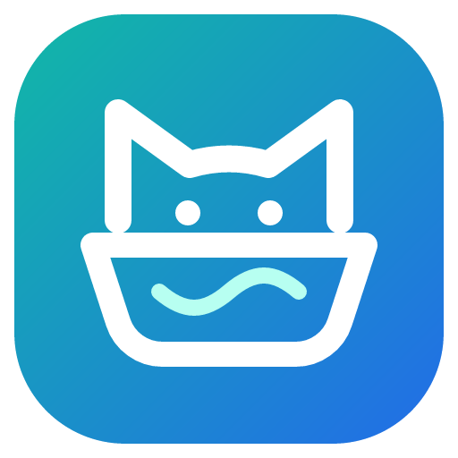

<!-- header:begin (generated from project metadata) -->
<h1 align="center">Cat Litter Hub – UPET / UBPet / AIRROBO / Robotail / Meowant</h1>

  

---

  
   
  
  
   
  
  
  
  

<!-- header:end -->

Eine Home-Assistant-Integration für smarte Katzenklos mit der gemeinsamen UBTECH-/Airrobo-API: **UPET, UBPet, AIR PET, AIRROBO, Robotail und Meowant**. Mehrere Konten, Anbieter und Kontoregionen lassen sich nebeneinander einrichten.

**Stand: 2026.11.02.1 · Hardwaretest mit dieser Version noch offen.** Die Kompatibilität der Software wird automatisiert geprüft. Ein passender API-Aufbau allein beweist noch nicht, dass jedes Modell alle Funktionen unterstützt.

## Was die Integration kann

- Eigenes Anbieterprofil und ausdrücklich gewählte Serverregion je Konto. Home-Assistant-Land und Zeitzone liefern nur die Vorauswahl.
- Eine dauerhafte, verschlüsselte MQTT-Verbindung je Konto für Statusmeldungen und Befehle. Kein lokaler MQTT-Broker erforderlich.
- REST-Abgleich standardmäßig alle drei Minuten, zusätzlich nach Besuchs- und Konfigurationsmeldungen. Maximal vier parallele REST-Aufrufe je Konto.
- Bestehende Status-, Gewichts-, Abfallbehälter-, Geruchsblock-, Diagnose- und Zeitplan-Entitäten bleiben unter der Domain `ubpet` erhalten.
- Besuchsverlauf mit dauerhaft gespeicherter Deduplizierung und bis zu 10.000 Besuchen je Katze. Mehrere Besuche zwischen zwei Abrufen werden berücksichtigt.
- Zusätzliche Sensoren für Besuche und Aufenthaltsdauer in 24 Stunden, Durchschnitt/Maximum, letzten Besuch und Gewichtsänderung zwischen zwei erfassten Besuchen.
- Präsenz-, Abdeckungs-, Trommel-, Waagen- und weitere Zustände aus den dekodierten Gerätemeldungen. Hardwareabhängige Entitäten werden anhand der gemeldeten Fähigkeiten angelegt.
- Automatische Reinigung, Verzögerung, Kindersicherung, Schüttelmodus, Behälterwarnung und bestätigte Zeitpläne steuern; Behälter und Geruchsblock zurücksetzen.
- Neue Geräte und Katzen werden während des Betriebs entdeckt. Katzen mit gleicher Cloud-ID in verschiedenen Konten bleiben getrennt.
- Deutsche Einrichtung und Entitätsnamen; herunterladbare Diagnosedaten mit ausgeblendeten Zugangsdaten, Geräte- und Haustierkennungen.

**Urin/Kot sind Schätzungen anhand der Besuchsdauer.** Die vorhandenen Entitäten und die einstellbare Dauerschwelle bleiben erhalten, heißen aber ausdrücklich „geschätzt“. Die API bestätigt damit keine Ausscheidungsart. Die Legacy-Aggregate der App bleiben separat sichtbar; sie sind nicht die Grundlage der neuen Besuchsstatistik.

## Installation und Umstieg

Home Assistant Core **ab 2023.6.0**; siehe [hacs.json](hacs.json). Den Stand der tatsächlich geprüften Versionen beschreibt [TESTEN.md](docs/TESTEN.md).

### HACS

1. In HACS unter **Benutzerdefinierte Repositories** dieses Repository als **Integration** hinzufügen:
   `https://github.com/seb5594/hass-catlitter-upet_airrobo_robotail_meowant-integration`
2. Cat Litter Hub installieren und Home Assistant neu starten.
3. Unter **Einstellungen → Geräte & Dienste → Integration hinzufügen** nach **Cat Litter Hub** suchen.

Solange diese Änderung nur auf einem Entwicklungsbranch liegt, den unten beschriebenen ZIP-Weg verwenden. Eine Veröffentlichung erfolgt über die gemeinsame Projekt-Pipeline.

### Bestehende UPET-/PnnnG-Installation ersetzen

Vor dem Wechsel eine Home-Assistant-Sicherung erstellen. **Den vorhandenen Konfigurationseintrag nicht löschen.** Den Ordner `custom_components/ubpet` durch den Inhalt der neuen Version ersetzen und Home Assistant neu starten. Beim manuellen ZIP enthält das Archiv direkt den Inhalt für diesen Ordner.

Entry-ID, Entity-Unique-IDs und vorhandene Kontodaten bleiben erhalten. Die gespeicherten Besuchsdaten und individuellen Dauerschwellen aus dem Multi-Region-Fork werden weiterverwendet. Alte Katzen-Gerätekennungen werden bei eindeutig zugeordneten Einträgen angepasst, ohne die Geräte-ID auszutauschen.

Es kann immer nur eine Implementierung derselben Domain `ubpet` geladen sein. Die eigenständige alte `robotail`-Domain wird nicht automatisch umgeschrieben; hierfür einen weiteren Cat-Litter-Hub-Eintrag anlegen.

## Konto einrichten

1. Die **App des Kontos** auswählen. Der Aufdruck auf dem Katzenklo ist dafür nicht ausschlaggebend.
2. Die **Serverregion des Kontos** und das bei der Registrierung verwendete Land angeben.
3. Konto und Passwort eingeben. Das Passwort wird unverändert übernommen und für den proprietären Login intern gehasht.
4. Für einen weiteren Anbieter oder ein weiteres Konto erneut **Eintrag hinzufügen** wählen.

| Auswahl | Backend | Einordnung |
| --- | --- | --- |
| UPET / UBPet | EU, Nordamerika, Japan/Korea, Russland | Regionale Endpunkte; Nordamerika hat eine andere App-Kennung |
| AIR PET / AIRROBO | Dieselben regionalen Airrobo-Endpunkte | Eigenes App-Profil; nicht automatisch aus der Hardwaremarke ableiten |
| Robotail | Regionaler Airrobo-Endpunkt mit Robotail-App-Kennung | EU im Quellfork beschrieben; andere Regionen hier noch ohne Hardwarebestätigung |
| Meowant | `apis.airrobo-home.com` | Fester NA/globaler Backend-Host; Kontoland trotzdem angeben |
| AIR PET auf `ubtrobot.com` | EU, Nordamerika, global, China | Experimentell: bekannte alternative Hosts, noch keine allgemeine Kontobestätigung |

Die Integration probiert Zugangsdaten **nicht automatisch an verschiedenen Servern** aus. Wenn die Anmeldung scheitert: zuerst App, Kontoregion und Kontoland vergleichen. Nach eindeutiger Passwortablehnung werden weitere automatische Anmeldeversuche für diesen Client gestoppt.

Der Hersteller erlaubt teilweise nur eine Sitzung pro Konto. Bei einer Verdrängung durch eine andere Anmeldung tritt die Integration mit wachsender Wartezeit zurück und pausiert auch REST-Anmeldungen. Ein separates, vom Besitzer freigegebenes Konto kann helfen; einige Einstellungen verlangen trotzdem Besitzerrechte.

## Datenqualität und Ressourcen

24-Stunden-Werte beziehen sich auf die importierten Herstellerdatensätze. Das Attribut `history_complete_24h` und der Diagnosesensor **Verlauf: Abruflimit erreicht** zeigen mögliche Lücken. Ein langer Ausfall mit mehr Datensätzen als dem Abruflimit lässt sich ohne bestätigte Pagination nicht vollständig rekonstruieren. Historische Importdaten werden nicht nachträglich in den Home-Assistant-Recorder geschrieben.

Die Optionen steuern REST-Intervall (60–3600 Sekunden), Abruflimit (20–200 Datensätze je Gerät und Verlauf) und MQTT. Mit deaktiviertem MQTT bleiben REST-Sensoren verfügbar; Gerätebefehle sind dann nicht verfügbar.

Fehler optionaler Endpunkte ersetzen vorhandene Werte nicht durch Nullwerte. Nicht vorhandene HTTP-Endpunkte werden eine Stunde lang nicht erneut angefragt. Routinemeldungen stehen auf Debug; Verbindungsprobleme werden beim Zustandswechsel gemeldet. Häufig wechselnde Zeitstempel-Diagnosesensoren sind bei neuen Installationen standardmäßig deaktiviert; bestehende Benutzereinstellungen bleiben bestehen.

## Entwicklung und Quellen

- [Gerätetest für C20 und Robotail](docs/TESTEN.md)
- [Aufbau und Erweiterungen](docs/ENTWICKLUNG.md)
- [Forks, Branches, Issues und offene Erkenntnisse](docs/QUELLEN.md)
- [Versionsschema und vorhandener Workflow](docs/WORKFLOW.md)
- [Änderungen](CHANGELOG.md)

Ausgangspunkt ist [CrazzyBerg/upet-hass](https://github.com/CrazzyBerg/upet-hass). Wichtige Protokoll- und Fehlerbefunde stammen aus [PnnnG](https://github.com/PnnnG/upet-hass-multi-region), [Robotail](https://github.com/hermeneanc/robotail-hass), [pfgcoder](https://github.com/pfgcoder/meowant-hass), [bojanrajkovic](https://github.com/bojanrajkovic/upet-hass) sowie den weiteren in der Quellenübersicht aufgeführten Forks.

## Name und Auffindbarkeit

**Cat Litter Hub** ist der unabhängige Integrationsname. Die Marken stehen im GitHub-Beschreibungstext, in Topics, im HACS-Namen und in dieser README. Der aktuelle Repository-Name kann bleiben; eine lange Keywordliste ist für die Auffindbarkeit nicht zwingend erforderlich.

UBPet bezeichnet sich offiziell als Marke von UBTECH; auch AIRROBO gehört laut eigener Unternehmensseite zu UBTECH. Daraus folgt keine belegte Eigentümerbeziehung zu Robotail oder Meowant. Die gemeinsame API ist hier die technische Klammer. Quellen: [UBPet](https://www.ubpet.com/pages/about-us), [AIRROBO](https://air-robo.com/pages/about-airrobo).

Empfohlene GitHub-Beschreibung:

> Home Assistant / HACS integration for UPET, UBPet, AIRROBO, AIR PET, Robotail and Meowant smart cat litter boxes. Multi-account, multi-region, MQTT push and visit statistics.

Empfohlene Topics:

`home-assistant` · `hacs` · `custom-integration` · `cat-litter` · `litter-box` · `smart-litter-box` · `ubpet` · `upet` · `airrobo` · `air-pet` · `robotail` · `meowant` · `mqtt` · `multi-account` · `multi-region`

## Herkunft und Lizenzstatus

Das Original und die untersuchten Forks enthalten zum Recherchezeitpunkt keine Lizenzdatei. [Upstream-Issue #8](https://github.com/CrazzyBerg/upet-hass/issues/8) fragt die Weitergabe ausdrücklich an. Dieses Projekt weist dem fremden Code deshalb keine erfundene Lizenz zu. Für eine allgemeine Veröffentlichung und eine Aufnahme in den HACS-Standardkatalog ist der Lizenzstatus mit den Rechteinhabern zu klären. Die bisherige Upstream-Historie und Quellenhinweise bleiben erhalten.

<!-- support:begin (generated, shared text) -->
## Say thanks

All my projects are built in my spare time, just for the fun of it. Still, they take a lot of time and care, and many of the smart home gadgets I buy end up here because I want to make them cloud-free and smart-home ready. Every bit of support means a lot to me.

If my work helped you or turned out to be useful, show your appreciation with a hot drink for my next sleepless night.

 
<!-- support:end -->
